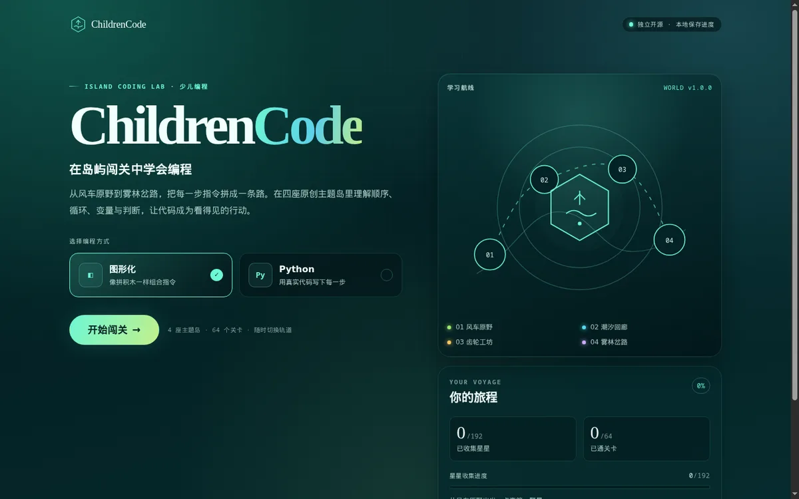
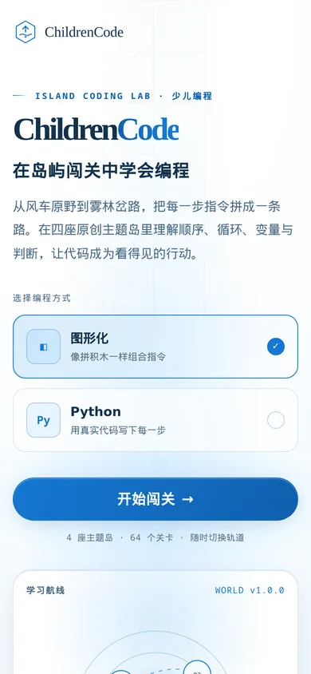

# ChildrenCode

开源、游戏化的少儿编程学习平台。四座原创主题岛，64 个关卡，用图形积木或 Python 风格文本指挥小车穿过网格。

## 这是什么

ChildrenCode 是一个面向编程启蒙的闯关游戏。玩家在风车原野、潮汐回廊、齿轮工坊和雾林岔路四座主题岛中，用顺序、循环、变量和条件判断完成任务。每关都有明确的目标和文字提示，通关后按完成情况、代码长度与运行步数结算一星到三星。

项目是纯前端静态应用，不需要注册、后端或数据库。学习进度保存在当前浏览器的 localStorage 中。所有场景、关卡、界面和文案均为原创。

## 截图

| 桌面首页 | 桌面关卡（逐帧播放） |
| --- | --- |
|  |  |

关卡页支持拖拽积木与逐帧播放。

手机端首页：



## 功能

- **64 个原创关卡**：4 座主题岛，每座 2 章，每章 8 关。难度从直线移动逐步推进到循环、变量和分支判断。
- **两条编程轨道**：图形化积木编辑器，以及 Python 风格的文本编辑器。两条轨道共享同一套指令模型和判定规则，可以随时切换。
- **拖拽式积木编辑器**：从指令栏拖到工作区即可插入；拖动已有积木左侧的手柄可以重排或嵌入重复、条件内部。点击添加与上下移动按钮保留为键盘替代。
- **逐帧执行动画**：运行后小车在舞台上按轨迹逐格移动并留下路径，播放结束或跳过后才显示结算。
- **三星评分**：完成关卡得 1 星，代码长度不超过参考解得 1 星，运行步数不超过参考解得 1 星。重复挑战只保留最好成绩。
- **进度与解锁**：星星是唯一的进度货币。关卡按顺序开放，章节和场景由星数门槛解锁，进度自动保存在本机。
- **2.5D 网格舞台**：CSS 绘制的立体棋盘，显示障碍、道具、终点、小车朝向，运行后标出走过的路径。
- **天蓝白云主题**：浅色天空背景、白色云层与蓝色强调色，桌面和手机布局一致。
- **提示与结算**：每关都有文字提示，部分关卡带分步引导。结算面板对照参考解，通关或失败两次后可以查看参考解。

## 快速开始

推荐使用 Bun。仓库用 Bun 管理依赖、运行测试和构建。

```bash
bun install
bun run dev
bun run build
bun test
```

`bun run dev` 启动开发服务器，按终端输出的地址打开页面。`bun run build` 把静态产物写入 `dist/`。`bun test` 运行全部单元测试。

其他可用命令：

```bash
bun run preview    # 预览 dist/ 中的构建产物
bun run typecheck  # TypeScript 类型检查
bun run verify     # 依次执行 typecheck、test、build
```

## 怎么玩

1. 在首页选择编程方式：图形化或 Python。进入关卡后也能在右上角切换。
2. 在世界地图选择已经解锁的主题岛，再在章节地图选择章节和关卡。
3. 从指令栏把积木拖到工作区；也可以点击指令栏追加到末尾。拖动已有积木左侧的手柄可以重排或嵌入重复、条件积木内部，数字输入框调整参数，上下箭头与删除按钮提供键盘替代。
4. Python 轨道直接在文本框中写代码。编辑器支持把当前积木程序载入文本区；点击运行时先解析文本，解析成功后指令树会同步回积木视图。
5. 点击“运行程序”后，小车在舞台上按轨迹逐格移动并留下路径；播放结束或点击“跳过播放”后，结算面板显示星级、代码长度和步数。

可用的积木：

| 积木 | 作用 |
| --- | --- |
| 前进 N 步 | 沿当前朝向前进，每一格都会检查边界和障碍 |
| 左转 / 右转 | 原地旋转 90 度 |
| 重复 N 次 | 重复执行内部指令 |
| 如果 / 否则 | 按条件选择执行的分支 |
| 设置变量 / 变量增加 | 给变量赋值，或在原值上累加 |

条件有三种：前方可通行、前方有道具、变量大于或等于某个阈值。

评分规则：

- 完成关卡，即到达终点并收集全部道具，得 1 星。
- 代码长度不超过 `parCode`，再加 1 星。
- 运行步数不超过 `parSteps`，再加 1 星。
- 代码长度按“开始积木 + 指令节点”计算。循环体只算一次，`if` 的两个分支都计入，不按执行次数放大。
- 一次运行最多执行 1000 个动作，单个重复最多执行 100 次。

## 内容矩阵

四座岛、每座两章、每章八关，合计 64 关。每章有 4 个检查点，每个检查点 2 关。每关满分 3 星，全流程共 192 星。

| 场景 | 编号 | 章节 | 核心概念 | 关卡 |
| --- | --- | --- | --- | --- |
| 风车原野 | `s01` | 顺风起航 / 逆风校准 | 移动与顺序 | 16 |
| 潮汐回廊 | `s02` | 潮起潮落 / 循环往复 | 循环 | 16 |
| 齿轮工坊 | `s03` | 计量与记录 / 条件分岔 | 变量与条件 | 16 |
| 雾林岔路 | `s04` | 岔路选择 / 复合判断 | 分支判断 | 16 |

解锁规则：第一个场景默认开放；章节解锁后，第一关默认开放。章节内后续关卡需要上一关至少拿到 1 星；每座岛的第二章需要上一章拿到 15/24 星；第 2 至 4 座岛需要上一座岛拿到 29/48 星。

## 项目结构

```text
childrencode/
├── src/
│   ├── App.tsx              # 视图切换、编程轨道与进度状态
│   ├── domain/              # 类型定义与指令辅助函数
│   ├── engine/              # 解析、模拟、评分与内容校验
│   ├── content/
│   │   ├── world.ts         # 四个场景包的汇总入口
│   │   └── scenes/          # 每座岛的场景包与关卡数据
│   ├── state/               # localStorage 进度与解锁规则
│   └── components/          # 首页、世界地图、章节地图、关卡与通用组件
├── docs/
│   ├── architecture.md      # 架构与引擎语义说明
│   └── replication-report.md
├── .github/workflows/       # GitHub Pages 部署工作流
├── index.html
├── vite.config.ts
└── package.json
```

测试文件与源码放在同一目录，命名为 `*.test.ts`。

## 部署到 GitHub Pages

仓库包含 `.github/workflows/deploy.yml`。推送到 `main` 分支，或在 Actions 页面手动触发工作流后，流水线会安装依赖、执行构建，并把 `dist/` 发布到 GitHub Pages。

首次部署前，在仓库的 Settings > Pages 中把发布来源设为 GitHub Actions。

`vite.config.ts` 使用 `base: "./"`，构建产物通过相对路径加载，因此可以部署在 `https://用户名.github.io/仓库名/` 这样的子路径下。应用没有 URL 路由，刷新页面会回到首页。

本地检查构建结果：

```bash
bun run build
bun run preview
```

## 原创说明

仓库内的场景、关卡、界面与文字均为本项目独立设计，代码以 MIT 许可证开源。领域模型、引擎语义和内容编写规则见 [docs/architecture.md](docs/architecture.md)。

本版本只实现图形化和 Python 两条轨道。

## 许可证

MIT，详见 [LICENSE](LICENSE)。
